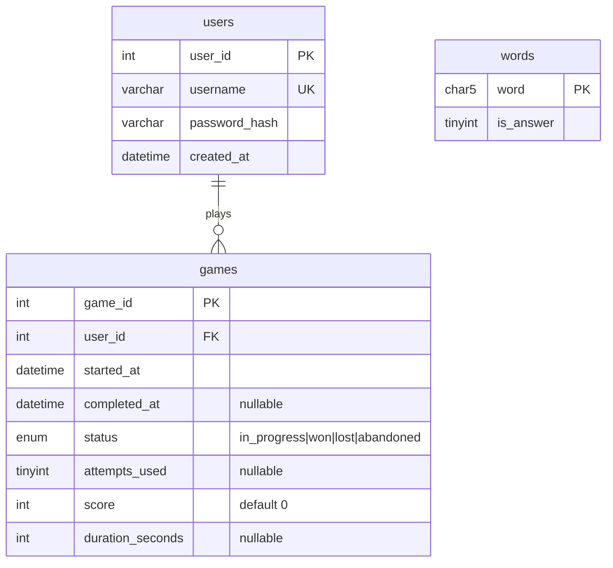

# Wordle – CSci 130 Group Project (Fall 2026)

Multi-page Wordle site. Game logic runs in browser JavaScript; PHP + Apache + MySQL/MariaDB provide the word list,
accounts, game records, statistics and leaderboard. No frameworks.

## Prerequisites
- Apache 2.4 with `mod_rewrite` enabled and `AllowOverride All` for the project folder
- PHP 8.1+ with `pdo_mysql` (and `curl` for the API test)
- MySQL 8 / MariaDB 10.4+ (adjust if your class DBMS differs)
- Node.js (optional, only for `tests/logic.test.js`)

## Installation
1. Copy this folder into Apache's web root, e.g. `htdocs/wordle` (site URL: `http://localhost/wordle/`).
2. Create the database and tables (script included):
   `mysql -u root -p < database/schema.sql`
3. Create a database user:
   ```sql
   CREATE USER 'wordle_user'@'localhost' IDENTIFIED BY 'change_me';
   GRANT SELECT, INSERT, UPDATE, DELETE ON wordle.* TO 'wordle_user'@'localhost';
   ```
4. Configure credentials: `cp config/config.example.php config/config.php` and edit it, **or** set the environment
   variables `DB_HOST`, `DB_PORT`, `DB_NAME`, `DB_USER`, `DB_PASS`, `MAX_DURATION_SECONDS` (default 7200).
5. Import the word dataset: `php database/seed_words.php` (re-run any time; it replaces the table contents).
   Files: `data/answers.txt` (possible targets) and `data/allowed.txt` (extra valid guesses).
6. Open `http://localhost/wordle/`.

Credentials stay on the server: `config/`, `database/`, `data/`, `tests/` and `api/lib/` are denied by `.htaccess`.
For HTTPS deployments the session cookie automatically gets the `Secure` flag.

## Tests
- `node tests/logic.test.js`
- `php tests/api_test.php http://localhost/wordle` (creates two test users)
- Manual cases and result table: `tests/test_plan.md`

## API (JSON; base path `/api`)
| Method and route | Purpose | Access |
|---|---|---|
| GET `/api/words` | `{answers:[...], allowed:[...]}` | Public |
| POST `/api/auth/register` | `{username, password}` → 201, logs in | Public |
| POST `/api/auth/login` | `{username, password}` → 200 | Public |
| POST `/api/auth/logout` | End session | Authenticated |
| GET `/api/me` | Current user + statistics | Authenticated |
| POST `/api/games/start` | Abandons unfinished game, returns `{game_id}` | Authenticated |
| POST `/api/games/{id}/complete` | `{won, attempts, duration_seconds}`; score computed on the server; once only (409 otherwise) | Authenticated owner |
| GET `/api/leaderboard?sort=&dir=` | `sort`: `username, score, games_played, total_time, completed_games`; `dir`: `asc, desc` (default score desc) | Public |

Status codes: 200/201 success, 400 invalid input, 401 not logged in, 403 not the owner, 404 unknown route/game,
405 wrong method, 409 duplicate username or duplicate completion, 415 non-JSON body, 503 empty word list, 500 server error.

## Database design

Statistics are computed from `games` rows (no cached totals, so history and totals cannot disagree).
Completed = `won` or `lost`; abandoned and in-progress games add no score or time. Games played counts every game row.
Tie-breakers on the leaderboard: completed games ↓, total time ↑, username ↑.

## Security notes
Passwords hashed with `password_hash` (bcrypt); server-side sessions in an HttpOnly, SameSite=Lax cookie with ID
regeneration on login; all SQL uses prepared statements; sort fields come from a whitelist; the server recomputes
scores and ignores any client-supplied totals; JSON-only POST bodies; output inserted into pages with `textContent`.
As the specification notes, the target word is chosen client-side, so this is a course project, not a tamper-proof game.

## Dataset citation
`data/answers.txt` and `data/allowed.txt` are a small original list of common English five-letter words compiled for
this project. **Replace them with the instructor-provided lists if available and cite the source here.**
